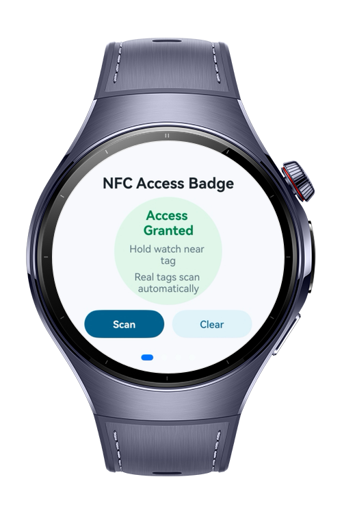
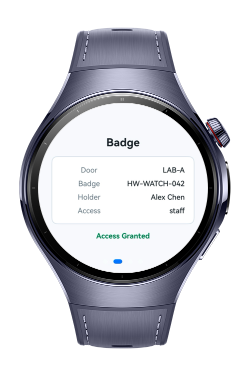
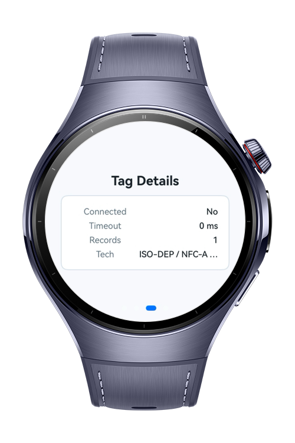
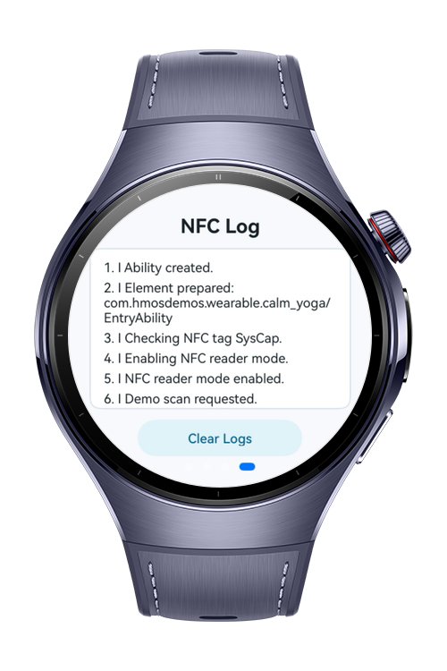

> **Note:** To access all shared projects, get information about environment setup, and view other guides, please visit [Explore-In-HMOS Index](https://github.com/Explore-In-HMOS/hmos-index).

# How to Build an NFC Access Badge

How To Build NFC Access Badge codelab demonstrates a compact reader-mode NFC workflow for HarmonyOS wearables.
A watch-friendly ConnectivityKit sample for scanning NDEF badge tags and showing an access decision.
The app combines foreground NFC reader registration, NDEF text payload parsing, NFC-A diagnostics,
demo scan support, in-app logging, and a multi-page Swiper interface for round watch screens.

# Preview
<div>
  
  
  
  
</div>

# Use Cases
- **Reader mode registration**: enable NFC foreground dispatch while the ability is in the foreground.
- **Demo badge scan**: run a deterministic badge check without requiring NFC hardware.
- **Real tag scan**: receive `TagInfo` callbacks from HarmonyOS reader mode and process them asynchronously.
- **NDEF badge parsing**: read NDEF records from a live tag or from a `TagInfo` snapshot.
- **Access decision**: parse `badgeId|holder|door|access` payloads and grant access for the sample lab policy.
- **Tag diagnostics**: display connection state, timeout, max transmit size, record count, UID, and NFC technology details.
- **NFC-A metadata**: read SAK and ATQA values when NFC-A metadata is available.
- **Debug log**: mirror NFC scan events to hilog and a bounded in-app log page.
- **Round watch UI**: use a four-page Swiper for ready, badge result, tag details, and logs.

# Technology

## Stack
- **Languages**: ArkTS / ArkUI
- **Frameworks**: HarmonyOS SDK 6.0.1(21)
- **Tools**: DevEco Studio, Hvigor
- **Libraries**:
  - `@kit.ConnectivityKit` (NFC reader mode, TagInfo, NDEF, NFC-A)
  - `@kit.ArkUI` (Swiper, Scroll, Button, Text, Column, Row)
  - `@kit.AbilityKit` (UIAbility, ElementName, lifecycle)
  - `@kit.BasicServicesKit` (BusinessError)
  - `@kit.PerformanceAnalysisKit` (hilog)

## Required Permissions
- `ohos.permission.NFC_TAG`

# Directory Structure
```
entry/src/main/
|---ets/
|   |---entryability/
|   |   |---EntryAbility.ets          # Registers and unregisters NFC reader mode
|   |---entrybackupability/
|   |   |---EntryBackupAbility.ets
|   |---pages/
|   |   |---Index.ets                 # Swiper-based watch UI and scan state binding
|   |---services/
|       |---NfcAccessBadgeService.ets # NDEF reading, badge parsing, and access decisions
|       |---NfcDebugLogger.ets        # hilog bridge and visible bounded log buffer
|       |---NfcTagDispatcher.ets      # Shared callback dispatcher between ability and UI
|---resources/
|   |---base/
|   |   |---element/
|   |   |   |---color.json
|   |   |   |---float.json
|   |   |   |---string.json
|   |   |---media/
|   |   |---profile/
|---module.json5                      # Wearable module and NFC_TAG permission
|---syscap.json                       # NFC Core and NFC Tag system capabilities
```

# Constraints and Restrictions
## Supported Devices
- Huawei Watch 5
- Wearable devices with `SystemCapability.Communication.NFC.Core` and `SystemCapability.Communication.NFC.Tag`

# License
NFC Access Badge is distributed under the terms of the MIT License.
See the [LICENSE](LICENSE) for more information.
